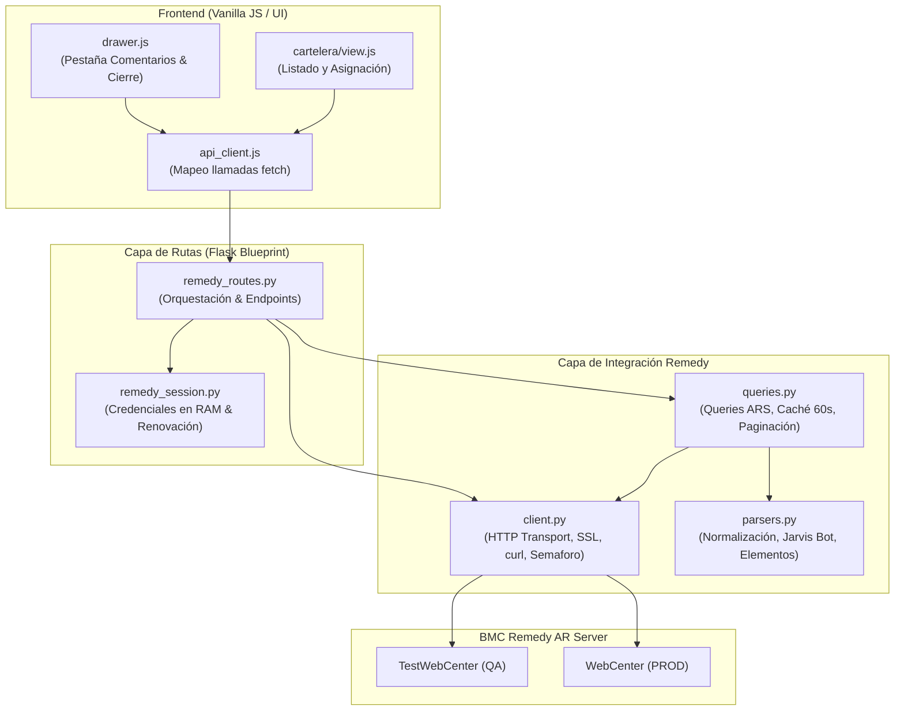
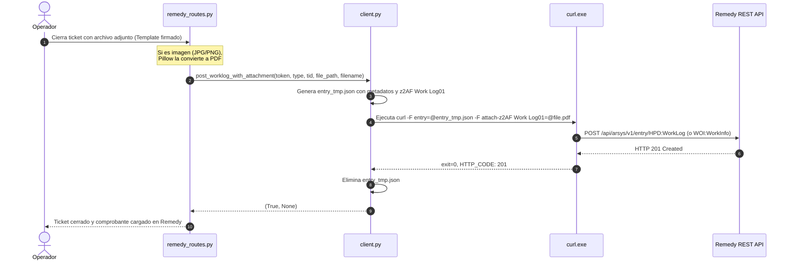

# Documentación Técnica de Integración con BMC Remedy — OrgWo

Este documento describe de manera exhaustiva cómo la aplicación **OrgWo** se comunica, autentica e interactúa con la API REST de **BMC Remedy (Action Request System - ARS)** o su motor integrado de simulación (Mock). Incluye los flujos de búsqueda de Incidentes (INC) y Órdenes de Trabajo (WO), envío de comentarios y archivos adjuntos, gestión de credenciales y entornos (QA vs. PROD vs. DEMO/MOCK), y la visualización interactiva de las bitácoras en la interfaz de usuario.

---

## Índice

1. [Arquitectura y Estructura de Módulos](#1-arquitectura-y-estructura-de-módulos)
2. [Entornos y Conexión de la API: QA vs. PROD](#2-entornos-y-conexión-de-la-api-qa-vs-prod)
3. [Autenticación, Credenciales y Renovación de Token](#3-autenticación-credenciales-y-renovación-de-token)
4. [Búsqueda y Consulta de Tickets (INC y WO)](#4-búsqueda-y-consulta-de-tickets-inc-y-wo)
5. [Envío de Comentarios y Archivos Adjuntos](#5-envío-de-comentarios-y-archivos-adjuntos)
6. [Visualización de Comentarios y Adjuntos en el Frontend](#6-visualización-de-comentarios-y-adjuntos-en-el-frontend)
7. [Referencia Rápida de Formularios y Endpoints ARS](#7-referencia-rápida-de-formularios-y-endpoints-ars)

---

## 1. Arquitectura y Estructura de Módulos

La integración con Remedy sigue un patrón desacoplado en capas dentro del Backend y Frontend:



### Responsabilidad de los Archivos Principales

*   [`Backend/config.py`]: Define las URLs base según el entorno (`ENV=QA` o `ENV=PROD`), las rutas de base de datos SQLite y las carpetas de almacenamiento de archivos.
*   [`Backend/servicios/remedy_session.py`]: Mantiene en memoria RAM las credenciales de los operadores para posibilitar la re-autenticación silenciosa del token JWT sin exponer contraseñas en cookies ni en disco.
*   [`Backend/integraciones/remedy/client.py`]: Capa de transporte HTTP puro. Maneja llamadas `urllib`, contexto SSL sin verificación para certificados corporativos, ejecutor `curl.exe` para adjuntos multipart, limitador de concurrencia (`BoundedSemaphore`) y formateador de errores ARS.
*   [`Backend/integraciones/remedy/queries.py`]: Construye las consultas sintácticas ARS (`q='...'`), ejecuta la caché en memoria (TTL 60 segundos) y gestiona la paginación.
*   [`Backend/integraciones/remedy/parsers.py`]: Convierte las respuestas crudas de Remedy en modelos limpios. Extrae clientes reales cuando el ticket viene del chatbot Jarvis, clasifica el tipo de equipo/periférico y normaliza estados.
*   [`Backend/api/remedy_routes.py`]: Controlador REST Flask. Expone endpoints para el frontend, controla la sesión de Remedy y el ciclo de vida del token JWT vía `before_request`.
*   [`Frontend/js/core/api_client.js`]: Cliente HTTP del frontend con `_remedyFetch`, gestión de errores y métodos para consultar y comentar tickets.
*   [`Frontend/js/ui/drawer.js`]: Implementa la carga (`loadRemedyComments`), visualización en tarjetas, previsualización de imágenes y descarga de adjuntos en la interfaz lateral del caso.

---

## 2. Entornos y Conexión de la API: QA vs. PROD

La aplicación soporta dos entornos de trabajo diferenciados por variables de entorno y scripts de inicio.

### URLs y Configuración

| Parámetro | Entorno QA (Testing) | Entorno Producción (PROD) |
| :--- | :--- | :--- |
| **Variable `ENV`** | `QA` (valor por defecto) | `PROD` |
| **URL Base Remedy** | `https://remedy-qa.yourcompany.com` | `https://remedy.yourcompany.com` |
| **Puerto Local** | `5001` | `5000` |
| **Base de Datos SQLite** | `database/data_qa.db` | `database/data.db` |
| **Script de Inicio** | [`iniciar_qa.bat`] | [`iniciar_prod.bat`] |
| **Status Reason Cierre INC** | `"No Further Action Required"` | `"19000"` |
| **Creación de Tickets UI** | Habilitada (`route_create_remedy_ticket`) | Bloqueada (retorna `HTTP 403`) |

### Definición en Código ([`Backend/config.py`])

```python
ENV = os.environ.get("ENV", "QA").upper()

if ENV == "PROD":
    DB_PATH = DATA_DIR / "data.db"
    BACKUP_DIR = BASE_DIR / "backups"
    REMEDY_BASE_URL = "https://remedy.yourcompany.com"
else:
    DB_PATH = DATA_DIR / "data_qa.db"
    BACKUP_DIR = BASE_DIR / "backups_qa"
    REMEDY_BASE_URL = "https://remedy-qa.yourcompany.com"
```

### Manejo de Certificados SSL Corporativos

Los servidores Remedy utilizan en ocasiones certificados autofirmados o inspeccionados por proxies corporativos. Para evitar fallos de apretón de manos SSL (`CERTIFICATE_VERIFY_FAILED`), [`Backend/integraciones/remedy/client.py`] inicializa un contexto seguro adaptado:

```python
def _make_ssl_ctx() -> ssl.SSLContext:
    ctx = ssl.create_default_context()
    ctx.check_hostname = False
    ctx.verify_mode = ssl.CERT_NONE
    return ctx
```

---

## 3. Autenticación, Credenciales y Renovación de Token

### 3.1. Endpoint de Login en Remedy

*   **Ruta ARS:** `POST /api/jwt/login`
*   **Content-Type:** `application/x-www-form-urlencoded`
*   **Header Obligatorio:** `X-AR-Client-Type: 34`
*   **Cuerpo (Payload):**
    *   `username`: Usuario corporativo / de red del operador.
    *   `password`: Contraseña del operador.
    *   `authString`: `"authenticationstring"` (parámetro mandatorio del AR Server de Remedy).
*   **Respuesta:** Retorna el **token JWT** en texto plano (`text/plain`).

### 3.2. Retención Segura de Credenciales en Memoria

Dado que el token JWT de Remedy vence tras **60 minutos** y Remedy **no dispone de endpoint `refresh_token`**, la única manera de no interrumpir al operador es re-autenticar de forma transparente en background.

Por motivos de seguridad corporativa:
1. Las contraseñas **NUNCA** se guardan en la base de datos SQLite.
2. Las contraseñas **NUNCA** se guardan en las cookies de sesión del navegador (Flask session), las cuales son firmadas pero legibles.
3. Se almacenan exclusivamente en memoria volátil del proceso en [`Backend/servicios/remedy_session.py`] mediante un diccionario protegido por un mutex (`threading.Lock`):

```python
_CREDS: dict[str, tuple[str, str]] = {}
_lock = threading.Lock()

def store_creds(user_id: str, remedy_username: str, password: str) -> None:
    with _lock:
        _CREDS[user_id] = (remedy_username, password)
```

Al reiniciar el servidor o cerrar sesión, este diccionario se destruye automáticamente.

### 3.3. Renovación Proactiva (Silent Renewal)

En [`Backend/api/remedy_routes.py`], el interceptor `@remedy_bp.before_request` inspecciona el token antes de procesar cada llamada:

1. Decodifica el bloque payload del JWT en Base64 para obtener el timestamp `exp`.
2. Calcula: `tiempo_restante = exp - timestamp_actual`.
3. Si `tiempo_restante <= 120` segundos (2 minutos antes del vencimiento):
   * Llama a `remedy_session.renew(user_id)`.
   * Ejecuta silenciosamente `client.remedy_login(username, password)`.
   * Sustituye el JWT en `session["remedy_token"]`.
4. Si la renovación falla o Remedy responde con `HTTP 401/403`:
   * Se captura la excepción `RemedyAuthenticationError`.
   * Se limpian las credenciales de memoria (`clear_creds`).
   * Se retorna `{ "error": "La sesión de Remedy expiró", "remedy_error": "TOKEN_EXPIRED" }` con código `HTTP 401`.

### 3.4. Control de Concurrencia (Saturación de AR Server)

Remedy AR Server limita los hilos y sesiones concurrentes por usuario y puede desalojar (evict) tokens si detecta exceso de llamadas paralelas. Para mitigar esto:
*   **Semáforo de Concurrencia:** En `client.py` existe `_REMEDY_MAX_CONCURRENCY = 8` (`threading.BoundedSemaphore(8)`), asegurando un máximo de 8 peticiones HTTP simultáneas hacia Remedy.
*   **Caché en Memoria:** En `queries.py`, las listas de tickets se almacenan en memoria con un TTL de 60 segundos (`_CACHE_TTL_SECS = 60`), reduciendo las consultas redundantes del equipo.

---

## 4. Búsqueda y Consulta de Tickets (INC y WO)

En BMC Remedy, los tickets se reparten en dos formularios según su naturaleza:
*   **Incidentes (INC):** Formulario `HPD:Help Desk` (creación vía `HPD:IncidentInterface_Create` y actualizaciones vía `HPD:IncidentInterface`).
*   **Órdenes de Trabajo (WO):** Formulario `WOI:WorkOrder` (creación vía `WOI:WorkOrderInterface_Create`).

### 4.1. Búsqueda Puntual por Identificador

Para consultar un ticket directo por su código (`INC...` o `WO...`), [`fetch_ticket_by_id`] ejecuta:

*   **INC:**
    *   **Formulario:** `HPD:Help Desk`
    *   **Query ARS:** `'Incident Number'="INC000000123456"`
*   **WO:**
    *   **Formulario:** `WOI:WorkOrder`
    *   **Query ARS:** `'Work Order ID'="WO000000123456"`

### 4.2. Búsqueda de Tickets No Asignados (Pool de Cartelera)

Muestra los tickets disponibles para ser tomados por los técnicos en la cartelera general:

*   **Incidentes (`fetch_unassigned_incidents`):**
    ```sql
    ('Assigned Group'="TECNOLOGIA USUARIOS DT" OR 
     'Assigned Group'="CTU DT" OR 
     'Assigned Group'="TECNOLOGIA CELULARES") 
    AND ('Assignee Login ID'=$NULL$ OR 'Assignee Login ID'="") 
    AND 'Status' < 4 AND 'Submit Date' >= {epoch_30_dias}
    ```
    *   `'Status' < 4`: Estados abiertos (1=Assigned, 2=In Progress, 3=Pending). Status 4 es Resolved.
*   **Work Orders (`fetch_unassigned_workorders`):**
    ```sql
    ('Support Group Name'="TECNOLOGIA USUARIOS DT" OR 
     'Support Group Name'="CTU DT" OR 
     'Support Group Name'="TECNOLOGIA CELULARES") 
    AND 'Status' < 3 AND 'Submit Date' >= {epoch_30_dias}
    ```
    *   `'Status' < 3`: Estados abiertos (1=Assigned, 2=Pending). Status 3 es Completed.
    *   Se aplica un post-filtro que descarta las entradas que ya tengan técnico en el campo `ASLOGID`.

### 4.3. Búsqueda de Tickets Asignados al Operador ("Mis Tickets")

Dado que en Remedy el operador puede estar registrado con o sin dominio (ej. `operador1`, `OPERADOR1`, `operador@yourcompany.com`), la función `_user_variants` genera todas las variantes posibles para la consulta:

*   **INC (`fetch_assigned_incidents`):**
    `('Assignee Login ID'="VARIANTE_1" OR 'Assignee Login ID'="VARIANTE_2") AND 'Status' < 4`
*   **WO (`fetch_assigned_workorders`):**
    `('ASLOGID'="VARIANTE_1" OR 'ASLOGID'="VARIANTE_2") AND 'Status' < 3`

### 4.4. Búsqueda en Historial de Tickets Cerrados / Resueltos

Para auditorías o importación histórica:
*   **INC (`fetch_closed_incidents`):** Filtra por `'Status' >= 4`. Si el usuario ingresa un texto de búsqueda (`search_q`):
    *   Si inicia con `INC` o es número: `'Incident Number' LIKE "%texto%"`
    *   Texto libre: `('First Name' LIKE "%texto%" OR 'Last Name' LIKE "%texto%" OR 'Description' LIKE "%texto%")`
*   **WO (`fetch_closed_workorders`):** Filtra por `'Status' >= 3`.
    *   Si inicia con `WO` o es número: `'Work Order ID' LIKE "%texto%"`
    *   Texto libre: `('Customer First Name' LIKE "%texto%" OR 'Customer Last Name' LIKE "%texto%" OR 'Summary' LIKE "%texto%")`

### 4.5. Normalización y Limpieza de Datos ([`parsers.py`])

1.  **Detección de Jarvis Chatbot:** Cuando los tickets son ingresados por el asistente automático corporativo (Jarvis), el solicitante en Remedy figura como "Jarvis". El parser ejecuta expresiones regulares sobre la descripción (`r"para el usuario:\s*([^)]+)"` y `r"(?:Solicitud|Consulta|Incidente):\s*(.*)"`) para extraer el nombre del usuario real y la necesidad verdadera.
2.  **Clasificación de Elemento (`parse_element_type`):** Analiza el título y la descripción buscando palabras clave para tipificar automáticamente: *Vincha, Kit (teclado/mouse), Celular, Cargador, Monitor, Red / Conectividad, Software / Configuración* o *Equipo*.
3.  **Corrección de Nombres y Empresas:** Aplica Title-Case (`smart_case_name`) a nombres que Remedy entrega en mayúsculas sostenidas y unifica empresas (`EMPRESA` $\rightarrow$ `Empresa Principal`, `SUBSIDIARIA` $\rightarrow$ `Subsidiaria`).
4.  **Typo Oficial de BMC:** En `HPD:Help Desk`, el campo de descripción detallada tiene un error tipográfico en el schema nativo de Remedy: se debe consultar como `Detailed Decription` (sin la 's').

---

## 5. Envío de Comentarios y Archivos Adjuntos

En BMC Remedy, las notas y los archivos no se adjuntan directamente en el ticket principal, sino creando registros asociados en los formularios de bitácora:
*   **Para Incidentes (INC):** Formulario `HPD:WorkLog`
*   **Para Órdenes de Trabajo (WO):** Formulario `WOI:WorkInfo`

### 5.1. Envío de Comentarios de Texto

Para registrar un comentario sin alterar el estado del ticket:

*   **Endpoint Interno:** `POST /api/remedy/tickets/<tid>/comments`
*   **Llamada a Remedy:** `POST /api/arsys/v1/entry/<Formulario_Comentarios>`
*   **Headers:**
    *   `Authorization: AR-JWT <token>`
    *   `Content-Type: application/json`
*   **Payload para INC (`HPD:WorkLog`):**
    ```json
    {
      "values": {
        "Incident Number": "INC000000123456",
        "Description": "Primeros 99 caracteres del comentario...",
        "Detailed Description": "Texto completo del comentario ingresado por el operador",
        "Work Log Type": "General Information",
        "Secure Work Log": "No",
        "View Access": "Internal",
        "z1D Action": "CREATE"
      }
    }
    ```
*   **Payload para WO (`WOI:WorkInfo`):**
    Utiliza el campo `"Work Order ID": "WO000000123456"` con los mismos campos de bitácora.

### 5.2. Envío de Archivos Adjuntos (PDFs y Evidencias)

La especificación multipart de BMC Remedy ARS exige que el JSON con los campos viaje como un archivo adjunto independiente denominado `entry` con `type=application/json`, y que el archivo binario viaje en una parte con prefijo `attach-` vinculado al nombre del campo de adjunto (`attach-z2AF Work Log01`).

Dado que la librería estándar de Python no formatea este multipart atípico de manera transparente para ARS, [`client.py`] utiliza el binario nativo de Windows `curl.exe`:



#### Código de Ejecución con `curl.exe` ([`client.py`]):

```python
cmd = [
    "curl", "-k", "-X", "POST", url,
    "-H", f"Authorization: AR-JWT {token}",
    "-F", f"entry=@{entry_tmp_path};type=application/json",
    "-F", f"attach-z2AF Work Log01=@{temp_file_path};type=application/octet-stream",
    "-w", "\nHTTP_CODE:%{http_code}\n"
]
result = subprocess.run(cmd, stdout=subprocess.PIPE, stderr=subprocess.PIPE, text=True, timeout=90)
```

#### Conversión Automática de Imágenes a PDF
Si el técnico adjunta una imagen fotográfica del comprobante (`.jpg`, `.jpeg`, `.png`, `.tif`, `.tiff`), [`Backend/api/remedy_routes.py`] la convierte automáticamente a formato PDF utilizando **Pillow** (`PIL.Image`) antes de transmitirla a Remedy.

---

## 6. Visualización de Comentarios y Adjuntos en el Frontend

La aplicación permite visualizar todo el historial de comentarios y descargar/previsualizar cualquier archivo adjunto registrado en Remedy directamente desde el panel lateral (Drawer).

### 6.1. Flujo de Extracción en Backend (`route_get_ticket_comments`)

1.  **Endpoint:** `GET /api/remedy/tickets/<tid>/comments`
2.  **Consulta al Formulario Adecuado:**
    *   Si es INC: `GET /api/arsys/v1/entry/HPD:WorkLog?q='Incident Number'="<tid>"`
    *   Si es WO: `GET /api/arsys/v1/entry/WOI:WorkInfo?q='Work Order ID'="<tid>"`
    *   **Campos solicitados:** `values(Description, Detailed Description, Submit Date, Submitter, z2AF Work Log01)`
3.  **Filtros de Limpieza (Reducción de Ruido):**
    *   **Remitentes de Sistema:** Se descartan comentarios generados por `ar_escalator`, `remedy application service`, `system`, `remedy`, `automation`.
    *   **Notas Automáticas del Tracker:** Se filtran notas automáticas como *"nota interna de cambio de estado"* o *"se entregó el equipo de reemplazo"*.
4.  **Extracción de Identificadores y Adjuntos:**
    *   Obtiene el `entry_id` desde `_links.self[0].href` (último segmento de la URL) o de `Request ID`.
    *   Lee el campo `z2AF Work Log01` que contiene el nombre del archivo si existe.
5.  **Ordenamiento:** Devuelve una lista JSON ordenada cronológicamente de forma descendente (los más recientes primero).

### 6.2. Endpoint de Descarga/Streaming de Adjuntos

*   **Ruta:** `GET /api/remedy/tickets/<tid>/attachments/<entry_id>/<field_name>`
*   **Conexión hacia Remedy:**
    `{REMEDY_BASE_URL}/api/arsys/v1/entry/{form_name}/{entry_id}/attach/{field_name}`
*   Transmite el flujo binario con las cabeceras originales `Content-Type` y `Content-Disposition`, permitiendo abrir o descargar el archivo en el navegador.

### 6.3. Renderizado en Interfaz de Usuario ([`Frontend/js/ui/drawer.js`])

Al abrir el Drawer lateral de un caso y presionar la pestaña **Comentarios** (`#drawer-tab-comments`), se dispara `loadRemedyComments(c)`:

```javascript
async function loadRemedyComments(c) {
    const loadingEl = document.getElementById('remedyCommentsLoading');
    const container = document.getElementById('remedyCommentsContainer');
    loadingEl.style.display = 'block';
    container.innerHTML = '';

    try {
        const comments = await API.getTicketComments(c.wo);
        loadingEl.style.display = 'none';

        if (!comments || comments.length === 0) {
            container.innerHTML = `<div class="empty">No hay comentarios registrados en Remedy.</div>`;
            return;
        }

        container.innerHTML = comments.map(comment => {
            let attachmentHtml = '';
            if (comment.attachment) {
                const attachUrl = `/api/remedy/tickets/${encodeURIComponent(c.wo)}/attachments/${encodeURIComponent(comment.id)}/z2AF%20Work%20Log01`;
                const isImage = /\.(png|jpg|jpeg|gif|webp)$/i.test(comment.attachment);
                
                if (isImage) {
                    attachmentHtml = `
                        <div style="margin-top: 8px;">
                            <a href="${attachUrl}" onclick="event.preventDefault(); window.previewAttachment(this.href, '${escapeHtml(comment.attachment)}');">
                                
                            </a>
                        </div>`;
                } else {
                    attachmentHtml = `
                        <a href="${attachUrl}" target="_blank" class="attachment-link">
                            <i data-lucide="file"></i> ${escapeHtml(comment.attachment)}
                        </a>`;
                }
            }

            return `
                <div class="comment-card">
                    <div class="comment-header">
                        <span><i data-lucide="user"></i> ${escapeHtml(comment.submitter)}</span>
                        <span><i data-lucide="clock"></i> ${formatDateTime(comment.date)}</span>
                    </div>
                    <div class="comment-desc">${escapeHtml(comment.description)}</div>
                    ${comment.detailed ? `<div class="comment-details">${escapeHtml(comment.detailed)}</div>` : ''}
                    ${attachmentHtml}
                </div>`;
        }).join('');

        renderIcons(); // Re-renderiza iconos de Lucide
    } catch (e) {
        loadingEl.style.display = 'none';
        container.innerHTML = `<div class="error">Error: ${escapeHtml(e.message)}</div>`;
    }
}
```

*   **Imágenes:** Si el archivo es una imagen, se incrusta una miniatura directamente en la tarjeta del comentario con zoom mediante modal.
*   **Documentos (PDF, etc.):** Se renderiza un botón con el icono del archivo que abre el documento en una nueva pestaña o lanza la previsualización modal (`window.previewAttachment`).

---

## 7. Referencia Rápida de Formularios y Endpoints ARS

| Operación | Formulario Remedy ARS | Método / Endpoint | Parámetros Clave |
| :--- | :--- | :--- | :--- |
| **Login JWT** | N/A | `POST /api/jwt/login` | `username`, `password`, `authString="authenticationstring"` |
| **Consultar INC** | `HPD:Help Desk` | `GET /api/arsys/v1/entry/HPD:Help Desk` | `q='Incident Number'="INC..."` |
| **Consultar WO** | `WOI:WorkOrder` | `GET /api/arsys/v1/entry/WOI:WorkOrder` | `q='Work Order ID'="WO..."` |
| **Tomar/Actualizar INC** | `HPD:IncidentInterface` | `PUT /api/arsys/v1/entry/HPD:IncidentInterface/<ReqID>` | `Assignee Login ID`, `Status="1"`, `Assigned Group ID` |
| **Tomar/Actualizar WO** | `WOI:WorkOrder` | `PUT /api/arsys/v1/entry/WOI:WorkOrder/<ReqID>` | `ASLOGID`, `Status="1"`, `Support Group ID` |
| **Crear INC** | `HPD:IncidentInterface_Create` | `POST /api/arsys/v1/entry/HPD:IncidentInterface_Create` | `z1D_Action="CREATE"`, `Description`, `Detailed_Decription`, `ServiceCI` |
| **Crear WO** | `WOI:WorkOrderInterface_Create` | `POST /api/arsys/v1/entry/WOI:WorkOrderInterface_Create` | `z1D_Action="CREATE"`, `Summary`, `Detailed Description` |
| **Bitácora INC** | `HPD:WorkLog` | `GET` / `POST /api/arsys/v1/entry/HPD:WorkLog` | `Incident Number`, `Detailed Description`, `z2AF Work Log01` |
| **Bitácora WO** | `WOI:WorkInfo` | `GET` / `POST /api/arsys/v1/entry/WOI:WorkInfo` | `Work Order ID`, `Detailed Description`, `z2AF Work Log01` |
| **Descargar Adjunto** | `HPD:WorkLog` / `WOI:WorkInfo` | `GET /api/arsys/v1/entry/<Form>/<EntryId>/attach/<Field>` | Field: `z2AF Work Log01` |
| **Detalles Usuario** | `CTM:People` | `GET /api/arsys/v1/entry/CTM:People` | `q='Remedy Login ID'="<user>"` |
| **Grupos de Soporte** | `CTM:Support Group Association`| `GET /api/arsys/v1/entry/CTM:Support Group Association` | `q='Login ID'="<user>" AND 'Status'="Enabled"` |

---

## 8. Módulo Admin: Estadísticas de los 3 Grupos y Jarvis Chatbot

Para la supervisión operativa del equipo, el sistema incluye un módulo exclusivo para administradores (`role === 'dispatcher'`) que analiza la totalidad de los tickets asignados a los 3 grupos de la mesa de soporte:
1. `TECNOLOGIA USUARIOS DT`
2. `CTU DT`
3. `TECNOLOGIA CELULARES`

### 8.1. Estrategia Anti-Saturación de WebCenter (Extracción Fragmentada)

La API REST de BMC Remedy (ARS) impone límites de hilos concurrentes y penaliza consultas masivas sin filtros restrictivos. Para consultar **todos los tickets asignados a los grupos** (sin limitarse únicamente al operador logueado) sin saturar WebCenter:

*   **Fragmentación por Grupo y Formulario:** La tarea se subdivide en 6 etapas secuenciales (3 grupos $\times$ 2 formularios: `HPD:Help Desk` y `WOI:WorkOrder`).
*   **Paginación en Lotes:** Se solicitan bloques de 100 registros con `limit=100` y `offset=N`.
*   **Pausa de Descanso:** Se inserta una pausa de 80ms entre solicitudes sucesivas para liberar el pool de conexiones de AR Server.
*   **Semáforo de Concurrencia:** Utiliza el semáforo acotado global (`_remedy_sem`) en `client.py`.
*   **Renovación Silenciosa:** Si el token JWT expira durante una sincronización prolongada, el worker lo renueva automáticamente en segundo plano (`remedy_session.renew`).
*   **Persistencia Local:** Los tickets se almacenan en la tabla SQLite `remedy_group_tickets` para que las consultas y filtros posteriores sean instantáneos.

### 8.2. Clasificación de Tickets JARVIS CHATBOT (Empresa Principal vs. Subsidiaria)

Dado que en Remedy los tickets abiertos por el bot automático figuran con el solicitante `"JARVIS"` y frecuentemente con la compañía por defecto de la cuenta del bot (`EMPRESA`), el sistema aplica un análisis especializado:

1.  **Detección de Jarvis:** Identifica si el ticket proviene del bot analizando el solicitante, el cuerpo del ticket (`para el usuario: ...`) o las etiquetas `JARVIS (...)`.
2.  **Extracción del Usuario Real:** Parsea el nombre del solicitante real desde la descripción del ticket o los campos nativos de Remedy.
3.  **Resolución Automática vía Outlook GAL:** Para usuarios que no contaban con historial previo en el tracker, el sistema consulta de forma automatizada la Libreta de Direcciones Global de Outlook (GAL) del operador activo utilizando el protocolo COM/ANR rápido de Windows. Obtiene su correo electrónico corporativo primario (`@yourcompany.com` vs `@subsidiary.com` vs `serv.externos`) y lo persiste en `users_directory`.
4.  **Regla de Negocio para Empresas Vinculadas:** Siguiendo las directrices corporativas configuradas:
    *   `EMPRESA`, `CORP`, `PRINCIPAL` $\rightarrow$ Clasificados como **Empresa Principal**.
    *   `SUBSIDIARIA`, `EXTERNOS` $\rightarrow$ Clasificados como **Subsidiaria**.
5.  **Cumplimiento de Privacidad y Anonimato:** En el reporte estadístico **NO se exponen nombres individuales**; se presentan exclusivamente las cantidades consolidadas y porcentajes de tickets cuyos usuarios reales pertenecen a **Empresa Principal** y a **Subsidiaria**.

### 8.3. Desglose y Filtrado por Meses Específicos (Empresa Principal vs. Subsidiaria y Tipificaciones)

Para responder a la necesidad de auditoría y seguimiento temporal de la demanda:

1.  **Filtro Global por Mes Específico:** En la barra de filtros del módulo de estadísticas de grupos, el selector **Mes** permite aislar meses individuales (ej. *Enero 2026*, *Febrero 2026*, etc.) calculados a partir de `Submit Date`. Al seleccionar un mes específico, todo el panel (KPIs, Jarvis, grupos, técnicos, elementos y estados) se recalcula exclusivamente para dicho mes.
2.  **Tabla de Evolución Mes a Mes:** Muestra cada período mensual con:
    *   Volumen total de tickets del mes.
    *   Cantidad y porcentaje exacto perteneciente a **Empresa Principal**.
    *   Cantidad y porcentaje exacto perteneciente a **Subsidiaria**.
    *   Cantidad y porcentaje de **Otros / No determinado**.
    *   Badges de las tipificaciones principales más frecuentes del mes.
3.  **Ficha Detallada de Tipificaciones por Empresa:** Permite inspeccionar en paralelo:
    *   Para **Empresa Principal**: distribución de hardware y tipologías (Equipo, Kit, Vincha, Celular, Red, Software, etc.) con barras de porcentaje y conteos exactos, más categorización nativa de Remedy.
    *   Para **Subsidiaria**: desglose equivalente para tickets cuyos usuarios pertenecen a Subsidiaria.
    *   Distribución por grupo de soporte asignado dentro del mes.


